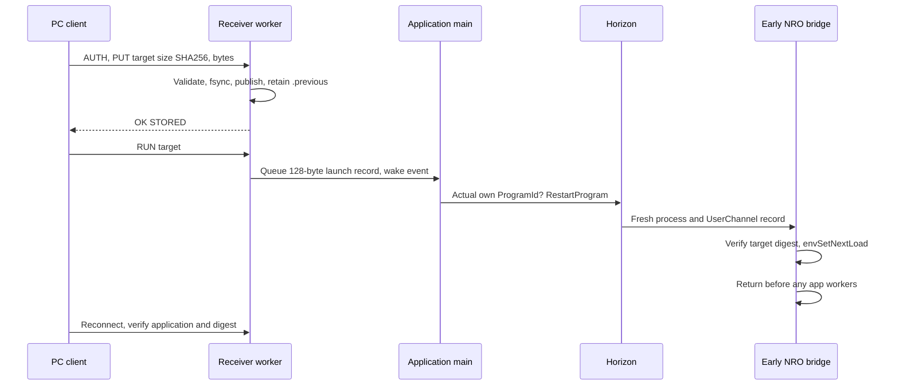

# Механизм и границы

## Порты

| Порт | Назначение |
|---|---|
| TCP 28285 | AUTH, STATUS, PUT, RUN, CRASH приёмника NRO. |
| TCP 28284 | AUTH и модульный протокол ARM lab. |
| TCP 28771 на ПК | Журнал nxlink, один приёмник на ПК. |
| 28280 на Switch | Первый hbmenu netloader; комплект его не заменяет. |
| TCP 22225 | Внешний GDB Atmosphère, если отдельно включён. |

Аутентификация — 64 hex-символа для reload, одинаковый локальный ключ для bootstrap/стенда. Это доверенная LAN, транспорт не шифруется. Не публикуйте `data/`, ключ в argv или runtime-логи с частными данными. В примерах нет общего встроенного пароля.

## Файлы и протокол

PUT принимает только BRIDGE/GAME/LAB, NRO 128 байт – 64 MiB. Проверяются ограниченная длина команды, размер файла, SHA, заголовок и page-aligned сегменты. BRIDGE дополнительно должен содержать NUL-terminated marker в rodata. Запись идёт в `.incoming`; валидированный файл публикуется с сохранением прежнего в `.previous`. Ошибка передачи не превращает частичный файл в запускаемый. Авария питания между переименованиями не является полноценной транзакционной гарантией файловой системы.

Launch record протокола 2: 128 байт — magic `APPRLD2\0`, enum target 2/3, token[65], IPv4 host[16], SHA[32], reserved[3]. Размер и назначение полей сохранены из исходной реализации; имена команд и magic обновлены вместе на всех концах. Протокол 1 несовместим с этой версией.

STATUS — versioned JSON, protocol=2, application/version/image SHA, marker, bridge_compatible/title_verified. CRASH читает только фиксированный `reload-bridge.log` и максимум два последних текстовых `.log` из Atmosphère crash_reports: до 4096 записей каталога, 32 KiB на отчёт, суммарно не более 66560 байт. Это может не включить нужный старый отчёт или его конец. Данные чужого процесса в отчёте не доказывают причину сбоя игры.

Фазовый trace сбрасывается только после распознанного launch record, не имеет nonce/времени и может остаться старым. Для подтверждения нового запуска нужны ожидаемый digest и независимый новый PID, а не один старый trace. TCP-open в трее тоже не доказывает исправность приложения.

## Почему основной поток

При системном запросе запуска appletMainLoop может завершить UI-цикл. Если network worker одновременно запускает другое приложение, а main возвращается загрузчику, код NRO может быть снят с живыми потоками. Поэтому worker только публикует запись с release/acquire и ждёт reply; owner main выполняет SDK-команды. Во время GAME main спит на UEvent, а не крутит таймер.

Одной последней проверки очереди перед выходом недостаточно: worker может находиться в RESERVED или прийти позже. Успешно запущенные resident workers отмечают время жизни процесса; finish никогда не возвращается loader при их наличии. Принятый системный запуск нельзя считать отменённым при последующей ошибке Exit.

## Перезапуск и фокус

Подтверждённый реальный ProgramId собственного title использует RestartProgram. Из чужого host нельзя бездумно вызывать «перезапустить текущее приложение»: перезапустится исходный host. Development Jump ранее возвращал исходную игру вместо нужного ярлыка и здесь не используется.

Первый явный запуск своего title через RequestLaunchApplication + managed Exit может создать процесс в Background. Тогда libnx ждёт фокуса ещё до main, а пользователь видит HOME. Это ожидание подтверждено GDB в исходном проекте, поэтому оно явно документировано как возможный ручной шаг bootstrap. Штатный собственный Restart был физически проверен без этого шага.

Комплект не управляет HOME/hbmenu, не устанавливает sysmodule и не имеет способа восстановить умерший сетевой приёмник. Его задача — повторяемая итерация при работающем приложении, а не доступ к выключенной консоли.
